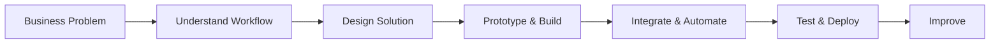

<div align="center">


### CRM Systems · AI Automation · Web Solutions · Business Operations

**I turn business workflows into practical digital systems.**

[](https://myfirstpresence.com)
[](https://www.linkedin.com/in/divyanshu-sharma-6ab114254/)
[](mailto:divyansh810ds@gmail.com)

</div>

---

## 👋 About Me

I'm **Divyanshu Sharma**, Founder of **[MyFirst Presence](https://myfirstpresence.com)**.

I work at the intersection of **business operations, CRM, automation and web technology**. I like understanding how a business actually works first — its leads, people, follow-ups, customers and repetitive processes — and then designing a digital system around that workflow.

> **Business problem → practical system → measurable, usable workflow.**

🔹 Building CRM & lead-management systems  
🔹 Creating AI calling and workflow automations  
🔹 Developing responsive websites & B2B digital experiences  
🔹 Designing role-based operational workflows and dashboards  
🔹 Connecting tools through APIs, webhooks and automation  
🔹 Using AI-assisted development to prototype, debug and ship faster

---

## 🚀 What I Build

<table>
<tr>
<td width="33%" valign="top">

### 📊 CRM & Sales

Lead management  
Customer records  
Sales pipelines  
Follow-ups & reminders  
Role-based access  
Team workflows  
Operational dashboards

</td>
<td width="33%" valign="top">

### 🤖 AI & Automation

AI calling workflows  
n8n automation  
Vapi integrations  
REST APIs  
Webhooks  
Google Sheets automation  
Lead qualification flows

</td>
<td width="33%" valign="top">

### 🌐 Web & Digital

Business websites  
B2B catalogues  
Responsive interfaces  
Enquiry flows  
Business demos  
Deployment  
Custom digital experiences

</td>
</tr>
</table>

---

## 🏢 Building MyFirst Presence

<table>
<tr>
<td width="70%" valign="top">

### Founder · Digital Solutions & Automation

**MyFirst Presence** is where I build practical digital solutions around real business requirements — from a company's first professional web presence to CRM workflows and automation systems.

My role spans **requirement discovery → solution planning → prototyping → implementation → integration → deployment**.

**Focus areas:** CRM · AI Automation · Business Websites · Workflow Systems

[**Visit MyFirst Presence →**](https://myfirstpresence.com)

</td>
<td width="30%" align="center" valign="middle">

### MFP
**Your First Presence.**  
**Made Right.**

`FOUNDER`

</td>
</tr>
</table>

---

## ⚡ Selected Systems & Projects

### 📈 CRM & Sales Systems
Custom workflow concepts and implementations covering **lead management, sales pipelines, customer records, follow-ups, targets, team roles, notifications and operational visibility**.

### ☎️ AI Calling & Lead Automation
Voice + workflow automation using **Vapi, n8n, APIs, webhooks, Google Sheets and Cloudflare** to connect conversations with structured lead and customer workflows.

### 🧩 MFP Business OS
An evolving business-management platform focused on **organization separation, role-based access, CRM workflows, internal communication, notifications and centralized operations**.

### 💬 WhatsApp & Lead Automation
Exploring customer-enquiry and lead-qualification workflows that connect business communication with CRM and automation logic.

### 🌐 Business Websites & B2B Catalogues
Responsive digital experiences for use cases across **education, industrial/B2B, professional services, security services and automotive businesses**.

---

## 🧰 Tech & Tools

<div align="center">

### Automation & AI


### Development


### Deployment & Workflow


</div>

---

## 🔄 How I Think About Solutions

<div align="center">



</div>

> I don't start with “Which technology should I use?” — I start with **“What is the business actually trying to solve?”**

---

## 🎯 Current Focus

```text
01  →  Building MyFirst Presence
02  →  CRM & sales workflow systems
03  →  AI calling + business automation
04  →  Reusable digital systems for real businesses
05  →  Turning manual operations into structured workflows
```

---

## 📊 GitHub Activity

<div align="center">


</div>

<sub>Most of my business/client repositories are private, so public GitHub statistics represent only part of my work.</sub>

---

<div align="center">

## 🤝 Build Something Useful

Have a business process that is still being managed manually or a workflow that should be simpler?

**Let's turn it into a practical digital system.**

[](https://myfirstpresence.com)
[](https://www.linkedin.com/in/divyanshu-sharma-6ab114254/)
[](mailto:divyansh810ds@gmail.com)

<br/>

**Divyanshu Sharma** · Founder, MyFirst Presence · Rajasthan, India


</div>
